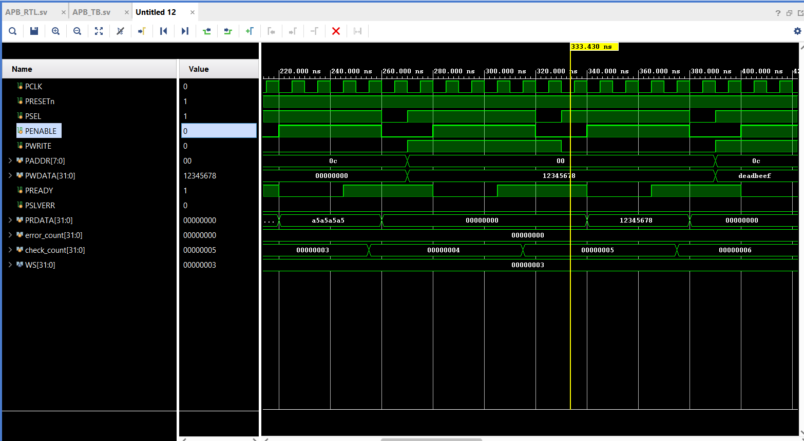
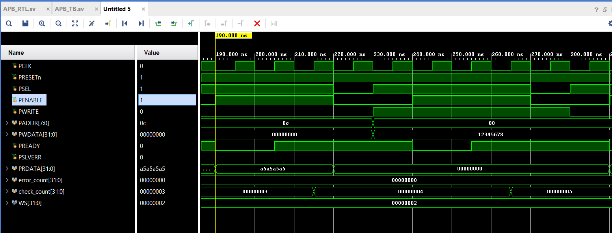

# APB Slave Design and Verification

A parameterized AMBA APB slave in SystemVerilog with configurable wait states, a four-register memory map, and error responses, verified with a self-checking SystemVerilog testbench and a UVM 1.2 environment, then synthesized and routed on an AMD XCK24 FPGA.

## Results at a glance

| | Result |
|---|---|
| Standalone testbench | 20 checks, 0 errors, at `WAIT_STATES` = 0, 1, 2 and 3 |
| UVM 1.2 environment | 10 of 10 transactions passed, 100% of covergroup bins, 0 UVM errors/warnings/fatals |
| Implementation (routed) | 41 LUTs, 98 registers, 0 BRAM, 0 DSP |
| Timing at 100 MHz | WNS +8.272 ns, WHS +0.148 ns, all internal timing constraints met |
| Target device | xck24-ubva530-2LVI-i, Vivado 2024.2 |

## Repository structure

```
RTL/            APB_RTL.sv              module APB_RTL
testbench/      APB_TB.sv               standalone self-checking testbench
UVM/            UVM 1.2 environment (see UVM/README.md)
CONSTRAINTS/    apb_slave.xdc           10 ns clock
REPORTS/        utilization and timing reports (routed)
WAVEFORMS/      simulation screenshots
```

## Design

Parameter: `WAIT_STATES` (default 2). It is fixed when the design is built, not changed at run time.

| Offset | Register | Access | Reset value |
|---|---|---|---|
| `0x00` | CTRL | Read/Write | `0x00000000` |
| `0x04` | DATA | Read/Write | `0x00000000` |
| `0x08` | STATUS | Read only | `0x00000001` (constant) |
| `0x0C` | SCRATCH | Read/Write | `0xA5A5A5A5` |

- **Wait states:** a counter holds `PREADY` low during the ACCESS phase for `WAIT_STATES` cycles, then `PREADY` goes high and the transfer completes.
- **Errors:** `PSLVERR` is asserted in the completion cycle for an access to an invalid address (read or write) and for a write to STATUS. Invalid-address reads return `0`.
- **Reset:** asynchronous, active low (`PRESETn`).
- **Combinational outputs:** `PREADY`, `PSLVERR` and `PRDATA` are generated combinationally from the APB inputs and the registers.

## Verification

### 1. Standalone SystemVerilog testbench

`testbench/APB_TB.sv` drives APB transfers, waits for `PREADY`, and checks `PRDATA` and `PSLVERR` on the completion edge. A watchdog stops the simulation if a transfer never completes. The wait-state setting is the `WS` parameter in the testbench.

Result: `TEST PASSED: 20 checks`, 0 errors. The same sequence passes at `WS` = 0, 1, 2 and 3.

| Scenario | Checks |
|---|---:|
| Reset values of all four registers | 4 |
| Write then read back CTRL and SCRATCH | 4 |
| Write to read-only STATUS: error asserted, STATUS unchanged | 2 |
| Invalid address read, invalid address write, unaligned address read (`0x10`, `0x10`, `0x01`): error asserted, read returns 0 | 3 |
| Invalid-address write did not alias onto a valid register (CTRL unchanged) | 1 |
| Reset after modifying registers: all four return to reset values | 4 |
| Back-to-back writes to CTRL and DATA, then read back | 2 |
| **Total** | **20** |

Note: the testbench confirms that transfers complete correctly at each wait-state setting. It does not assert the exact number of wait cycles; that is visible in the waveforms below.



*Write of `0x12345678` to `0x00` with `WAIT_STATES = 3`. `PREADY` is low for 3 wait cycles and high on the 4th; `PSLVERR` stays low.*



*Read of `0x0C` followed by a write of `0x12345678` to `0x00` with `WAIT_STATES = 2`. In each transfer `PREADY` is low for 2 wait cycles and high on the 3rd edge, completing the transfer. `PSLVERR` stays low.*

### 2. UVM 1.2 environment

The `UVM/` folder holds a UVM environment with a sequence item, sequence, sequencer, driver, monitor, scoreboard (expected register model), agent, environment and test. It was simulated with QuestaSim on EDA Playground.

| Metric | Result |
|---|---:|
| Transactions checked | 10 |
| Scoreboard passed / failed | 10 / 0 |
| Functional coverage | 100% of the bins defined in the covergroup |
| UVM errors / warnings / fatals | 0 / 0 / 0 |

100% means every bin in the testbench's covergroup was hit. It does not mean complete APB protocol coverage. See `UVM/README.md` for details.

## FPGA implementation

Vivado 2024.2, routed design, device xck24-ubva530-2LVI-i, 10 ns clock (100 MHz), default `WAIT_STATES = 2`.

| Resource | Used |
|---|---:|
| CLB LUTs | 41 (all as logic) |
| CLB registers | 98 |
| CLBs | 12 |
| BRAM / DSP | 0 / 0 |
| BUFGCE | 1 |
| Bonded IOB | 79 of 81 |

The 98 registers are three 32-bit registers (CTRL, DATA, SCRATCH) plus the 2-bit wait counter. STATUS is a constant and uses no flip-flops.

| Timing metric | Result |
|---|---:|
| WNS (setup) | +8.272 ns |
| WHS (hold) | +0.148 ns |
| Pulse-width slack | +4.725 ns |
| TNS / THS / TPWS | 0 |
| Failing setup / hold endpoints | 0 / 0 |

**Qualification:** only the 10 ns clock was constrained. No external input or output delays were specified (44 inputs and 34 outputs have none), and `PREADY`, `PSLVERR` and `PRDATA` are combinational from the inputs. These results therefore show internal register-to-register timing under the 100 MHz clock, not complete external APB interface timing.

## Reproducing the results

Tools: AMD Vivado 2024.2 (simulation and implementation), QuestaSim with UVM 1.2 (UVM environment).

1. Add `RTL/APB_RTL.sv` as a design source, `testbench/APB_TB.sv` as a simulation source, and `CONSTRAINTS/apb_slave.xdc` as a constraint.
2. Simulation top: `APB_TB`. Set `WS` in the testbench to 0, 1, 2 or 3, then run `run all`.
3. Synthesis top: `APB_RTL`. Run synthesis and implementation, then `open_run impl_1`, `report_utilization` and `report_timing_summary`.

## Limitations

- The slave supports 32-bit word transfers only; there is no `PSTRB` or `PPROT` handling.
- Verification is directed (20 checks) plus a small UVM run (10 transactions). There is no randomized or protocol-compliance checking and no formal verification.
- The testbench checks results at each wait-state setting but does not assert the wait-cycle count.
- External I/O timing was not constrained (see the qualification above).
