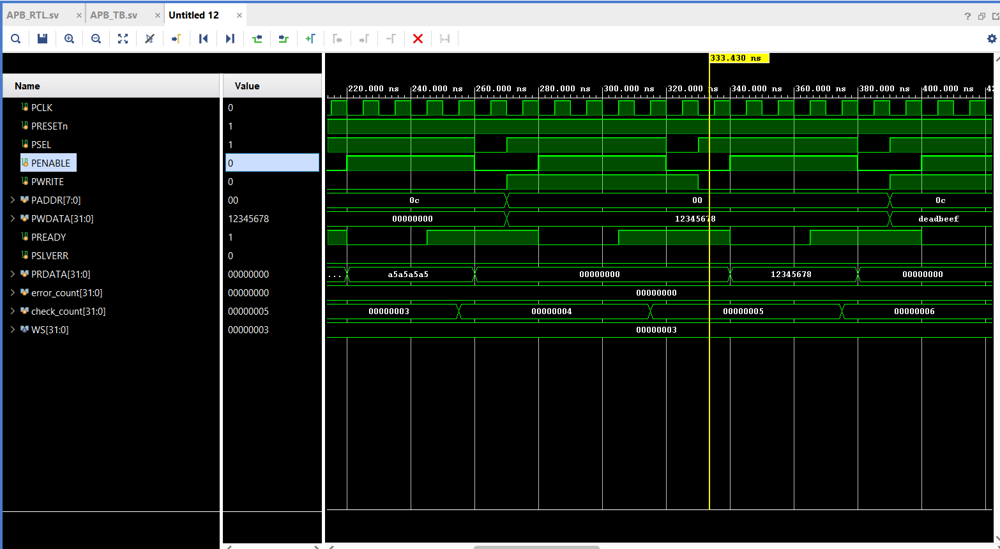
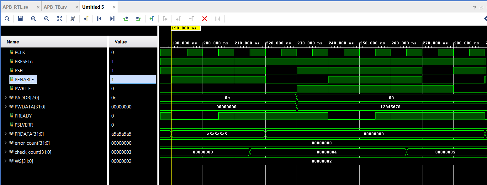

# APB Slave Design and Verification

A parameterized AMBA APB slave implementation using SystemVerilog, with configurable wait states and a self-checking testbench.

## Overview

This project implements a simple APB slave supporting memory-mapped register access, configurable wait-state insertion, and error handling for invalid transactions.

The design is verified through a SystemVerilog testbench using Vivado simulation.

## Features

### RTL Design
- Parameterized wait-state configuration using `WAIT_STATES`.
- Four memory-mapped registers:
  - `0x00` – Control Register (Read/Write)
  - `0x04` – Data Register (Read/Write)
  - `0x08` – Status Register (Read Only)
  - `0x0C` – Scratch Register (Read/Write)
- Configurable wait-state generation using a counter.
- `PREADY` handshake-based transaction completion.
- `PSLVERR` response for invalid addresses and writes to read-only registers.
- Asynchronous active-low reset.

### Verification
- Self-checking SystemVerilog testbench.
- Read and write transaction verification.
- Reset-value and reset-recovery testing.
- Configurable wait-state testing.
- Invalid-address access testing.
- Read-only register protection.
- Back-to-back register write testing.
- Data integrity checks using expected values.
- Simulation watchdog to detect stalled transactions.

## Project Structure

```text
   apb-slave-sv/
   ├── RTL/
   │   └── APB_RTL.sv
   ├── testbench/
   │   └── APB_TB.sv
   ├── waveform_ws3_write.png
   └── README.md
```

## Tools Used

- SystemVerilog
- AMD Vivado 2024.2


## Configuration

The number of wait states can be changed through the `WS (wait_states)` parameter in the testbench.

```systemverilog
localparam int WS = 3;
```

Try different configurations such as 0, 1, 2 and 3 to observe the effect on transaction timing.

## Simulation

1. Add `APB_RTL.sv` and `APB_TB.sv` to a Vivado project.
2. Set `APB_TB` as the simulation top module.
3. Run behavioral simulation.
4. Observe APB signals and transaction timing in the waveform.
5. Check the simulation transcript for transaction results and the final test summary.

## Verification Scenarios

| Scenario | Expected Behaviour |
|---|---|
| Read/write valid registers | Successful transaction |
| Write to read-only status register | Error response |
| Access invalid address | Error response |
| Read invalid address | Zero data with error |
| Reset | Registers return to reset values |
| Wait-state insertion | Transfer completes when PREADY is asserted |
| Back-to-back writes | Both register values are retained |


## Simulation Results



*Write of 0x12345678 to 0x00 with WAIT_STATES=3. PREADY is low for 3 wait cycles and high on the 4th; PSLVERR stays low.*




*Read of 0x0C followed by a write of 0x12345678 to 0x00 with WAIT_STATES=2. In each transfer PREADY is low for 2 wait cycles and high on the 3rd edge, completing the transfer. PSLVERR stays low.*
